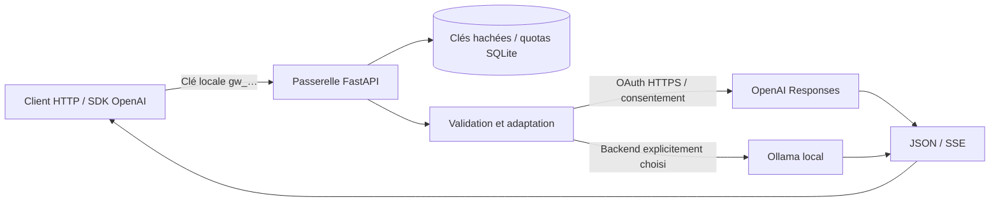

# Passerelle ChatGPT

[](https://github.com/Alexisdevpro/passerelle-chatgpt/actions/workflows/ci.yml)
[](LICENSE)

Une passerelle personnelle qui permet à des clients compatibles OpenAI d'utiliser les requêtes éligibles de leur abonnement ChatGPT, après connexion et consentement via **Sign in with ChatGPT**. Elle expose une partie de Responses et Chat Completions, avec texte, photos et streaming.

**English:** A personal, self-hosted gateway for the documented Sign in with ChatGPT flow. It exposes a limited OpenAI-compatible API with local access keys, quotas, image inputs and streaming. Each operator connects their own eligible account. See [the English guide](docs/README.en.md).

Ce projet indépendant est distribué sous licence MIT. Il n'est ni affilié à OpenAI, ni approuvé par OpenAI. Les requêtes consomment les quotas du compte autorisé ; l'accès et les modèles disponibles dépendent du compte et des règles du fournisseur. Aucun backend OpenAI facturé à la clé n'est implémenté, et il n'y a pas de basculement automatique vers une API payante.

## Ce que la passerelle apporte

- Connexion OAuth propre à l'application : PKCE, vérification OIDC et renouvellement des jetons.
- Clés locales révocables, modèles autorisés et plafonds journaliers dans SQLite.
- Réponses texte en JSON ou SSE, sur les deux routes ; images en entrée sur le backend ChatGPT.
- Validation explicite des paramètres et erreurs pour les fonctions non prises en charge.
- Backend Ollama sélectionnable explicitement, distinct du compte ChatGPT.
- Administration en ligne de commande ; conteneur non privilégié et stockage persistant.



## Installation locale

Python **3.12 ou supérieur**, Git et un navigateur pour la connexion ChatGPT. Les commandes suivantes utilisent `python` ; sous Windows, utiliser `py -3.14` pour créer l'environnement si nécessaire.

```bash
git clone https://github.com/Alexisdevpro/passerelle-chatgpt.git
cd passerelle-chatgpt
python -m venv .venv
```

Activer l'environnement : `source .venv/bin/activate` sous Linux/macOS, ou `.\.venv\Scripts\Activate.ps1` sous PowerShell.

```bash
python -m pip install -r requirements.lock
python -m pip install --no-deps .
python -m gateway.cli init
python -m gateway.cli login
python -m gateway.cli models
```

La connexion ouvre le navigateur et demande le consentement pour utiliser le plan ChatGPT. Si ce droit est refusé ou indisponible, les inférences ChatGPT échouent explicitement. Aucune session d'un autre logiciel, aucun cookie et aucune clé API OpenAI ne sont nécessaires.

Choisir un identifiant réellement retourné par `models`, puis démarrer :

```bash
python -m gateway.cli set-default --model VOTRE_MODELE --effort auto
python -m gateway.cli serve
```

Le service écoute sur `http://127.0.0.1:8787`. La clé initiale se trouve dans `.local/client-key.txt`. Les exemples suivants lisent ce fichier uniquement sur la machine qui héberge la passerelle ; sur un autre appareil, transmettre une clé locale dédiée par un canal privé.

## Premier appel

Installer le SDK client : `python -m pip install openai`.

```python
from pathlib import Path
from openai import OpenAI

client = OpenAI(
    base_url="http://127.0.0.1:8787/v1",
    api_key=Path(".local/client-key.txt").read_text().strip(),
)

answer = client.responses.create(
    model="passerelle-default",
    input="Explique le fonctionnement d'une passerelle API en deux phrases.",
)
print(answer.output_text)

stream = client.chat.completions.create(
    model="passerelle-default",
    messages=[{"role": "user", "content": "Bonjour !"}],
    stream=True,
)
for chunk in stream:
    if chunk.choices and chunk.choices[0].delta.content:
        print(chunk.choices[0].delta.content, end="", flush=True)
```

Pour les scripts dans [examples/](examples/), définir `GATEWAY_API_KEY` avec une clé locale, `GATEWAY_BASE_URL` si l'adresse change, et éventuellement `GATEWAY_MODEL`. [Photos et vision](PHOTOS.md) décrit les images en entrée.

## Contrat et limites

| Disponible | Limite |
|---|---|
| `GET /v1/models`, `GET /v1/models/{model}` | Un catalogue visible ne garantit pas l'accès à l'inférence |
| `POST /v1/responses` | Texte et images en entrée ; texte en sortie ; JSON ou SSE |
| `POST /v1/chat/completions` | Adaptation vers Responses ; une seule réponse |
| `GET /healthz` | Santé du processus, sans authentification |
| `GET /readyz`, `GET /openapi.json` | Authentification obligatoire |
| Historique explicite | Envoyer les messages à chaque requête |
| Outils, audio, fichiers, embeddings, génération d'images | Non implémentés dans cet adaptateur |
| Paramètres sans équivalence | Refus explicite, dont `temperature`, `top_p`, `store:true` et plafonds de tokens sur OAuth |

Ce contrat couvre une partie de l'API ; il ne promet pas une compatibilité complète. Voir [COMPATIBILITY.md](COMPATIBILITY.md) et [openapi.json](openapi.json).

## Exploitation et contribution

[DEPLOYMENT.md](DEPLOYMENT.md) explique Docker, la connexion d'un serveur personnel, les sauvegardes et HTTPS. Le dépôt publie le logiciel ; chaque opérateur héberge sa propre instance et connecte son compte. Il ne fournit pas de service d'inférence partagé.

[SECURITY.md](SECURITY.md) décrit les limites de confiance et les signalements privés. [CONTRIBUTING.md](CONTRIBUTING.md) donne les commandes de test ; [TEST-REPORT.md](TEST-REPORT.md) distingue les vérifications automatisées des appels réels. Les journaux de production et secrets ne sont pas distribués.

Les prochaines améliorations sont dans [ROADMAP.md](ROADMAP.md). Les contributions à la portabilité, aux tests de compatibilité et à la documentation sont bienvenues. Voir [CHANGELOG.md](CHANGELOG.md) et la [licence MIT](LICENSE).

## Références du fournisseur

Le fonctionnement et l'accès restent soumis à la documentation et aux conditions d'OpenAI : [présentation du flux OSS](https://developers.openai.com/siwc/token-sharing-open-source), [connexion](https://developers.openai.com/siwc/token-sharing-open-source/sign-in), [serveurs personnels](https://developers.openai.com/siwc/token-sharing-open-source/self-hosted-vms), [limites](https://developers.openai.com/siwc/token-sharing-open-source/preview-limitations). Vérification documentaire : 7 novembre 2026.

